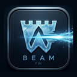

<p align="center">
  
</p>

<h1 align="center">Frostwall Beam</h1>

<p align="center">
  <strong>Encrypted file transfer for your local network — or across the internet.</strong><br />
  Pair two devices with a short code, verify with a rotating check digit, and send files or folders with end-to-end encryption — no cloud account, no tracking.
</p>

<p align="center">
  <a href="https://github.com/batu3384/frostwall-beam/actions/workflows/ci.yml"></a>
  <a href="LICENSE"></a>
  
  
</p>

---

## Overview

**Frostwall Beam** is a cross-platform desktop app (macOS & Windows) for fast, private file transfers — on the same LAN, or between two devices on different networks. Remote pairing uses a shareable iroh ticket (plus the SPAKE2 digits); no hosted mailbox is required. It combines a frost-themed UI with a security-first Rust core: SPAKE2 pairing, per-chunk AEAD encryption, Blake3 integrity checks, and explicit receiver approval before any payload is written to disk.

Built with **Tauri 2**, **Rust**, and **React** — one codebase, native installers, offline-friendly fonts, and minimal webview privileges.

## Highlights

| Area | What you get |
|------|----------------|
| **LAN discovery** | Pure-Rust mDNS — no system Bonjour dependency on Windows |
| **Internet mode** | NAT traversal + relay fallback via `iroh` (QUIC). Default: copy an invite. Optional self-hosted mailbox for 6-digit lookup |
| **Pairing** | 6-digit code + key-confirmation MAC + 30s rotating verification code; send stays blocked until the user confirms the codes match |
| **Transfer** | Files & folders, drag-and-drop, live speed/ETA, collision-safe renames |
| **Control** | Accept/decline incoming manifests; cancel in-flight transfers without disconnecting |
| **UX** | TR/EN UI, system/dark/light theme, transfer history, reduced-motion support |

## Features

### Security & privacy
- **End-to-end encryption** — XChaCha20-Poly1305 on every chunk
- **MITM-resistant pairing** — SPAKE2 + ephemeral X25519 + human-verifiable rotating code
- **Integrity** — per-file Blake3 hash verified before commit
- **Receiver gate** — manifest reviewed and accepted before bytes hit disk
- **Path hardening** — traversal, parent-path symlinks, Windows junctions, dangerous Unicode, system directories, and Windows device names rejected
- **Forward secrecy** — fresh session keys each pairing

### Networking
- **Same network**: zero-config mDNS discovery, direct LAN socket, **multi-host selection** when several peers advertise
- **Different networks**: pick **Remote** on both devices. The host copies an invite (iroh `EndpointTicket` + pairing digits, relay URL + direct IPs); the joiner pastes it. `iroh` dials by public key over QUIC — direct when NAT allows, otherwise relayed. An optional mailbox lets joiners type only the 6-digit code
- The mailbox, if used, stores `code → EndpointId` plus relay/IP dial hints for a few minutes so joiners can type six digits — it never sees file contents, keys, or the SPAKE2 handshake (see [Internet mode](#internet-mode-different-networks) below)

### Transfer experience
- Send **files or entire folders** (structure preserved)
- **Drag-and-drop** or native file/folder picker
- **Configurable download directory** and **device name** (shown in mDNS + UI)
- **Cancel** an active transfer while keeping the encrypted session open

### Desktop polish
- Native dialogs and minimal Tauri capability surface
- Frost-themed UI with status pill, toasts, and progress breakdown
- Local transfer history (last 50 entries)

## Quick start

### Prerequisites

- [Node.js](https://nodejs.org/) 20+ and [pnpm](https://pnpm.io/)
- [Rust](https://rustup.rs/) stable (for Tauri backend)
- Platform tooling for [Tauri](https://v2.tauri.app/start/prerequisites/) (Xcode CLT on macOS, MSVC on Windows)

### Run from source

```bash
git clone https://github.com/batu3384/frostwall-beam.git
cd frostwall-beam
pnpm install
pnpm tauri dev
```

### Build installers

```bash
pnpm tauri build
```

| Platform | Output |
|----------|--------|
| macOS | `.app` / `.dmg` under `src-tauri/target/release/bundle/` |
| Windows | `.msi` / `.exe` under the same bundle directory |

> **Windows note:** Unsigned builds may trigger SmartScreen on first run. For distribution, Authenticode-sign the artifacts with `signtool` and your code-signing certificate.

## How to use (two devices)

1. **Host (Device A)** — *Host a session*. Same Wi‑Fi: share the 6-digit code. **Remote:** copy the invite and send it (message, mail, …). Same Wi‑Fi is not required.
2. **Join (Device B)** — pick the **same** network mode as the host → *Join a session* → enter the code **or paste the invite** → *Connect* (pick a host if multiple appear on the LAN).
3. **Verify** — both screens show the same **rotating 6-digit code**. Tap **codes match** (or **Kodlar aynı**) before sending; a mismatch disconnects.
4. **Send** — drag files/folders onto the drop zone or use the file picker.
5. **Receive** — on the target device, review the manifest → **Accept** or **Decline**.
6. **Files land in** `~/Downloads/Frostwall Beam` by default, or your chosen folder in **Settings**.

**Single-machine smoke test:** run two app instances after `pnpm tauri build` — one hosts, one joins.

## Internet mode (different networks)

mDNS and a direct LAN socket only work when both devices share a network — there is no router config or relay involved at all. To reach a device on **another network or behind another NAT**, two more things are needed: a way for the two devices to find each other's address, and a way to actually open a connection once NAT/firewalls are in the way. Internet mode adds exactly that, without touching anything below it — SPAKE2 pairing, AEAD encryption, Blake3 integrity, and the transfer protocol are byte-for-byte the same on both paths.

```
Same network:      mDNS discovery        →  direct LAN TCP socket
Different networks: iroh ticket invite or optional mailbox (code → EndpointId + dial hints)
                          → iroh QUIC (hole-punch, relay fallback)
                                                          ↓
                                    SPAKE2 pairing → AEAD frames → Blake3 (unchanged)
```

- **[`iroh`](https://www.iroh.computer/)** gives each endpoint a public-key identity (`EndpointId`) and dials by key instead of IP: it tries a direct QUIC connection first (hole-punching through most home NATs) and falls back to n0's HTTPS websocket relay when UDP is blocked. DNS uses the OS resolver (`getaddrinfo`) so scoped IPv6 in `/etc/resolv.conf` does not force a dead Google-UDP fallback. Transport encryption sits on top of Frostwall's own AEAD layer.
- **Invite (default):** the host shares an iroh `EndpointTicket` plus the 6-digit SPAKE2 code (relay URL + globally reachable IPs; loopback, RFC1918, CGNAT, and IPv4-mapped private omitted) so the joiner can dial without a mailbox. If the first invite has no HTTPS relay, the host keeps hunting ~25s and rewrites the invite when a relay homes — copy again. Legacy `fwb2-<id>-<code>-<addrs>` and `fwb1-<id>-<code>` still parse. SPAKE2 still authenticates the session.
- The **mailbox** is an optional convenience (this repo's `mailbox/` crate) that maps a 6-digit code to the host's `EndpointId` and dial hints (relay URL, shareable IPs). Entries last about 10 minutes unless the still-waiting host refreshes them. It is *not* a relay and never touches file data. Set its URL in **Settings → Pairing server** if you want joiners to type six digits instead of pasting the invite.

### Optional: deploying your own mailbox

```bash
# Default bind is loopback. Public listen: MAILBOX_BIND=0.0.0.0 PORT=8787
cargo run --release -p frostwall-mailbox

# Or build once and run the binary
cargo build --release -p frostwall-mailbox
./target/release/frostwall-mailbox
```

Put it behind TLS (a reverse proxy like Caddy/Nginx, or any platform that terminates HTTPS for you — Fly.io, a small VPS with Caddy, etc.) and point both devices at `https://your-mailbox.example.com` in **Settings**. The service is stateless (in-memory, short TTL) and trivial to size: one instance comfortably serves many simultaneous pairings.

## Security model

```
Pairing code (SPAKE2)  →  session keys (HKDF)  →  encrypted frames (AEAD)
                              ↓
                    rotating liveness code (human check)
                              ↓
              manifest validation  →  user approval  →  chunked transfer + Blake3
```

- Wire protocol is versioned; incompatible peers fail fast.
- **LAN control plane** (manifest, accept/reject, cancel) is AEAD-encrypted with a session `control_key` derived alongside payload keys — metadata is not sent in plaintext on the local network.
- **Internet mailbox** must use HTTPS in release builds (plain `http://127.0.0.1` is allowed only for local dev). Registration returns a one-time token; unregister requires that token. First successful register wins for a code (no hijack overwrite).
- Pairing codes are validated (six digits) and handshake reads are bounded (`HANDSHAKE_TIMEOUT`, stall attempt limits) to resist slowloris-style hangs.
- Transfers are **serialized** per session (one direction at a time, atomic `in_flight` gate) to keep UX and state simple.
- Temp files use a `.frostwallpart` suffix, are `fsync`'d, and are atomically renamed only after hash verification. Crash leftovers are swept on the next receive.
- Name collisions become `file (1).txt`, `file (2).txt`, … — never silent overwrite.
- **Transport is not trust** — whether bytes arrive via a direct LAN socket or an `iroh` QUIC path (direct or relayed), pairing and encryption above are identical. The mailbox and any relay only ever see opaque `EndpointId`s / encrypted QUIC traffic, never plaintext, file data, or pairing material.

## Architecture

```
src-tauri/src/
├── crypto.rs       HKDF, XChaCha20-Poly1305, HMAC
├── pairing.rs      SPAKE2 + key-confirmation
├── liveness.rs     30s rotating verification code
├── discovery.rs    mDNS advertise / browse (same network)
├── internet.rs     iroh endpoint + mailbox HTTP client (different networks)
├── transport.rs    length-delimited framing over any duplex byte stream
├── protocol.rs     Manifest · Accept · Reject · Cancel · Chunk · FileEnd · Done
├── transfer.rs     encrypt/decrypt, Blake3, path confinement
├── session.rs      handshake orchestration
├── config.rs       persisted user settings (download dir, device name, mailbox URL)
└── commands.rs     Tauri API + session coordinator

mailbox/src/lib.rs   optional rendezvous: code → EndpointId + dial hints (self-host)
mailbox/src/main.rs  standalone `frostwall-mailbox` binary

src/
├── App.tsx         main UI (pairing, transfer, settings)
├── i18n.tsx        Turkish / English strings
├── errors.ts       backend error → localized message
├── history.ts      local transfer log
└── theme.ts        system / dark / light preference
```

`src-tauri` and `mailbox` are members of one Cargo workspace (root [`Cargo.toml`](Cargo.toml)). The desktop app talks to a mailbox only if you set an HTTPS URL in Settings; it does not start a localhost mailbox. Deploy `frostwall-mailbox` separately if you want 6-digit Remote lookup. They share the tiny JSON contract in [Internet mode](#internet-mode-different-networks).

## Development

```bash
# Frontend tests + typecheck + production bundle
pnpm test
pnpm build

# Rust tests for the whole workspace (app + mailbox; 4 network-dependent
# tests are #[ignore]d — mDNS multicast and three live n0 iroh round-trips —
# since they need real LAN/internet access that CI/sandboxes don't guarantee)
cargo test --workspace

# Lint / format (optional)
cargo fmt --all
cargo clippy --workspace --all-targets -- -D warnings
```

CI runs on every push to `main` via [`.github/workflows/ci.yml`](.github/workflows/ci.yml) — Rust test+clippy on Linux, macOS, and Windows; frontend `pnpm test` + `pnpm build`.

## Roadmap

- [ ] Optional QR-code for the Remote invite (today: copy/paste the ticket)
- [ ] Multi-peer sessions over the internet (today: LAN only)

## Contributing

Issues and pull requests are welcome. Please run `cargo test --workspace`, `cargo clippy --workspace --all-targets -- -D warnings`, `pnpm test`, and `pnpm build` before submitting changes.

## License

[MIT](LICENSE) © [batu3384](https://github.com/batu3384)
