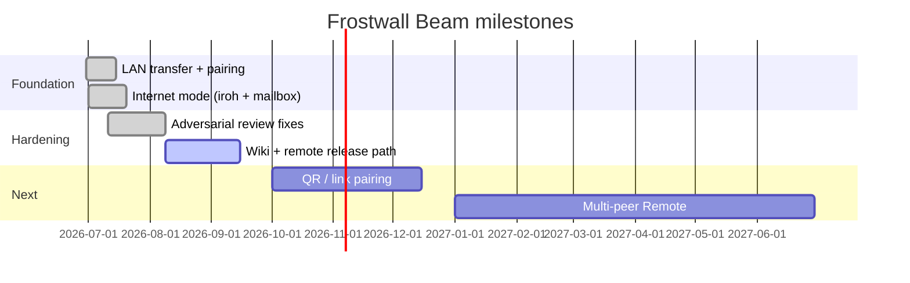

# Roadmap

> Milestones grounded in shipped work (README, adversarial audit plan, main branch). No speculative features.

**Status legend:** `Done` · `Now` · `Next` · `Later`

Track bugs and requests: [Issues](https://github.com/batu3384/frostwall-beam/issues) · Security: [Security advisories](https://github.com/batu3384/frostwall-beam/security/advisories)

## Now

| Item | Status | Notes |
|------|--------|-------|
| Hosted mailbox release path | Now | Document + ship `FROSTWALL_MAILBOX_URL` for production Remote mode |
| Wiki + operator docs | Now | This wiki; mailbox TLS deploy guide in Getting Started |
| Signed Windows installers | Now | Authenticode for SmartScreen-friendly releases |

## Next

| Item | Status | Notes |
|------|--------|-------|
| QR / link pairing for Remote | Next | README backlog — skip typing long codes |
| Multi-peer Remote sessions | Next | README backlog — LAN multi-host exists; internet is 1:1 today |
| Dependabot + advisory CI gate | Next | `cargo deny` / dependency audit in CI |

## Later

| Item | Status | Notes |
|------|--------|-------|
| Automated release artifacts | Later | CI-built `.dmg` / `.msi` on tag |
| Linux desktop target | Later | Not in current platform matrix |

## Completed (Done)

| Item | Status | Notes |
|------|--------|-------|
| Tauri 2 app + LAN transfer | Done | mDNS, SPAKE2, AEAD chunks, Blake3 |
| Internet mode foundation | Done | `iroh`, mailbox workspace, host/join commands |
| Adversarial review hardening | Done | Control-plane AEAD, mailbox token auth, pairing bounds |
| Embedded mailbox + UX polish | Done | Dynamic localhost port, `remoteAvailable` gate, theme tokens |
| CI: test + clippy + frontend build | Done | `.github/workflows/ci.yml` |

## Timeline (approximate)

## How priorities change

1. Open an [issue](https://github.com/batu3384/frostwall-beam/issues/new) with use case and impact.
2. Security regressions jump the queue — use [private advisory](https://github.com/batu3384/frostwall-beam/security/advisories/new).
3. `Now` items should fit in ~1–2 release cycles; `Next` when `Now` clears.
